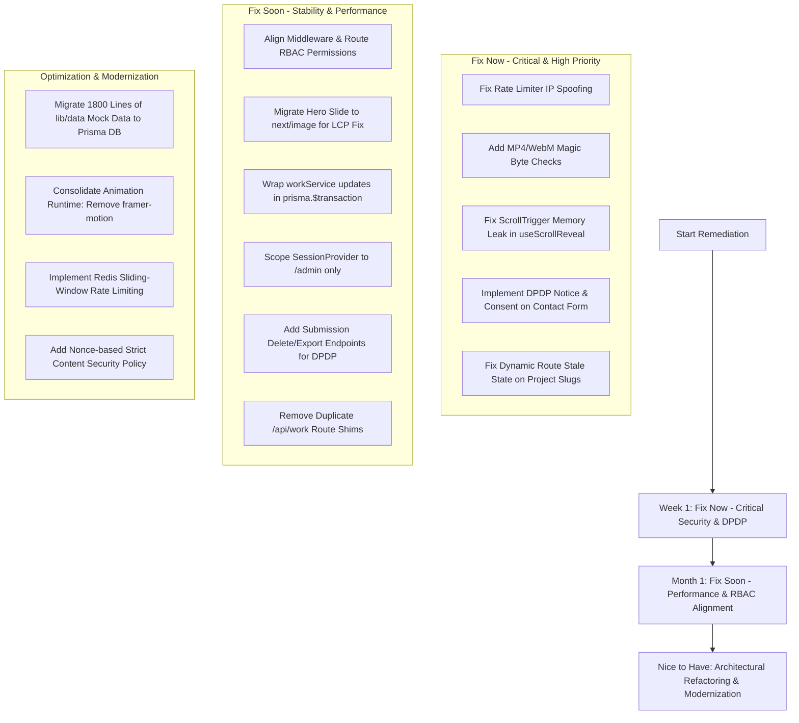

# COMPREHENSIVE CODEBASE, PERFORMANCE, SECURITY & DPDP ACT COMPLIANCE AUDIT
**Target Application:** CRE8TIVECOVE (C8C) — Creative Agency & Digital Production Platform  
**Auditor:** Senior Software Engineer & Application Security / DPDP Reviewer  
**Audit Date:** October 30, 2026  
**Scope:** Full repository audit (Frontend, Next.js Server Components, Server Actions / API Handlers, Database Layer, Middleware, Assets, Security Headers & Privacy Compliance)  
**Status:** READ-ONLY AUDIT REPORT (No codebase files modified)

---

## 1. Executive Summary

### 1.1 Project Overview & Architecture Summary
> **Stack Summary (Step 0):**  
> The application is a full-stack digital creative agency and content management platform built on **Next.js 14.2.35 (App Router)** with **React 18.3.1**, **TypeScript 5.6.3**, and **Tailwind CSS 3.4.14**.  
> The backend layer uses **Prisma ORM 5.21.1** over **SQLite** (`prisma/dev.db`), with database queries executed inside Next.js Server Components and route handlers under `/app/api/`.  
> Authentication is managed via **NextAuth v4.24.10** utilizing a stateless JWT session strategy secured with bcryptjs (12 rounds) and a custom in-memory inactivity tracker.  
> The client experience incorporates high-fidelity animation and layout systems powered by **GSAP 3.12.5 (with ScrollTrigger & @gsap/react)**, **Framer Motion 12.4.7**, and **Lenis 1.1.18** for smooth inertia scrolling.  
> Deployment is containerized using multi-stage Alpine Docker configurations (`Dockerfile`, `docker-compose.yml`) with local file-system media uploads routed through `/public/uploads/`.

### 1.2 Overall Health Scorecard

| Audit Area | Health Score (/10) | Rating | Key Summary |
| :--- | :---: | :---: | :--- |
| **1. Code Quality** | **6.5 / 10** | Needs Improvement | Strong TypeScript base, but weakened by pervasive `any` casts, disconnected form labels, and route structure misplacements. |
| **2. Code Review (PR Style)** | **6.0 / 10** | Needs Improvement | Stale closure/state anti-patterns on dynamic pages, lack of database transactions on cascade updates, and RBAC mismatches. |
| **3. Architecture & Best Patterns** | **6.5 / 10** | Fair | Good service layer abstraction (`lib/services/`), but bogged down by 1,800 lines of hardcoded static data and misplaced root components. |
| **4. Unnecessary Code & Packages** | **6.0 / 10** | Fair | Heavy dual animation runtimes (GSAP + Framer Motion), dead CSP allowances, duplicate proxy API routes, and orphaned DOM queries. |
| **5. React.js Performance** | **5.5 / 10** | Poor | Critical LCP bottlenecks (CSS `background-image` in hero banner), severe GSAP ScrollTrigger memory leaks, and DOM layout thrashing on scroll. |
| **6. Application Security** | **6.0 / 10** | High Risk | IP-spoofing vulnerability in rate limiter, video upload magic byte bypass, lack of JWT revocation upon user deactivation, and weak CSP directives. |
| **7. DPDP Act 2023 Compliance** | **2.0 / 10** | Non-Compliant | Total absence of statutory privacy notices, unbundled consent checkboxes, consent records, consent withdrawal, and data subject rights. |

---

### 1.3 Top 5 Critical Vulnerabilities & Architectural Risks

1. **[CRITICAL - DPDP Compliance] Absence of Statutory Notice & Affirmative Consent (DPDP Act §5 & §6):**  
   The primary lead inquiry form (`app/contact/ContactPageClient.tsx`) collects personal data (name, email, business details, IP address) without presenting an itemized privacy notice, without a link to a Privacy Policy, and without capturing an unambiguous affirmative opt-in. This violates Sections 5, 6, and 12 of India’s Digital Personal Data Protection Act 2023, exposing the business to maximum statutory regulatory penalties (up to ₹250 Crore under Section 33 and the DPDP Schedule).

2. **[CRITICAL - Security] Rate Limiter IP Spoofing & Serverless State Bypass (`lib/rate-limit/index.ts`):**  
   The `getClientIp` function unconditionally trusts unverified client-supplied HTTP headers (`X-Forwarded-For`, `CF-Connecting-IP`, `X-Real-IP`). Any remote actor or bot can spoof IP addresses at will, completely circumventing login brute-force protections (`authOptions.ts:27`) and contact form anti-spam limits (`contact/route.ts:20`). Furthermore, the in-memory `Map` state fails to synchronize across multi-process container instances or serverless deployments.

3. **[CRITICAL - Performance] Uncleaned GSAP ScrollTrigger Listeners & SPA Memory Leak (`lib/hooks/useScrollReveal.ts`):**  
   The `useScrollReveal` hook instantiates ScrollTrigger instances on every client route transition without maintaining an instance registry or invoking `ScrollTrigger.kill()` / `gsap.context().revert()` upon unmount. In single-page navigation, scroll event listeners and DOM references accumulate indefinitely in memory, leading to browser thread degradation, stutter, and mobile browser crashes.

4. **[HIGH - Security] Incomplete File Upload Magic Byte Validation & Arbitrary Video Storage (`lib/storage/mediaUpload.ts`):**  
   The media upload handler verifies magic bytes for JPEG, PNG, GIF, and WebP, but explicitly bypasses checks for `video/mp4` and `video/webm` by returning `true` unconditionally (lines 42–44). An authenticated user or attacker can upload arbitrary binary payloads or disguised executables up to 25MB directly into the public web root (`/public/uploads/`).

5. **[HIGH - Code Logic & Data Integrity] Stale Derived State Anti-Pattern & Navigation Freeze (`app/work/[slug]/WorkDetailClient.tsx`):**  
   `WorkDetailClient` and `ServiceDetailClient` initialize state using `useState(() => initialWork)`. When users navigate between case studies or services, React preserves the mounted component instance; however, because the prop updates are ignored and `useEffect` aborts immediately when `initialWork` is truthy, the UI remains permanently frozen on the previous project while the URL updates.

---

## 2. Findings Tables Across All 7 Audit Areas

### Area 1: Code Quality
| ID | Severity | File:Line | Issue | Recommended Fix | Effort |
| :--- | :---: | :--- | :--- | :--- | :---: |
| **CQ-01** | Medium | `app/page.tsx:30-35`, `app/about/page.tsx:30-32`, `app/work/page.tsx:45` | Pervasive `any` and `any[]` typing across server pages and client props, disabling TypeScript type safety. | Define unified TypeScript interfaces (`SiteSettingsData`, `CmsAboutData`, `WorkItem`) in `lib/types/` and apply them strictly. | M |
| **CQ-02** | High | `app/contact/ContactPageClient.tsx:148-218`, `components/admin/FormField.tsx:22` | Accessibility (WCAG 2.1 A): Disconnected `<label>` and `<input>` elements. No `id` on inputs, no `htmlFor` on labels. | Add unique `id` to all `<input>`, `<textarea>`, `<select>` and link labels via `htmlFor`. | S |
| **CQ-03** | Low | `app/HeroSection.tsx:67` & `app/HomePageClient.tsx:62` | Typo in DOM identifier: `id="heding-section"` patched with fallback `document.getElementById('heading-section') \|\| document.getElementById('heding-section')`. | Correct the ID typo in `HeroSection.tsx` to `heading-section` and remove the fallback lookup. | S |
| **CQ-04** | Medium | `app/contact/ContactPageClient.tsx:20, 216-248` | Misnamed form state: Service selection dropdown binds to `formData.budget`, causing confusing Admin UI outputs (`Budget: Web Development`). | Rename field in client state and API schema to `serviceCategory` or `requestedService` while keeping budget distinct. | M |
| **CQ-05** | Medium | `app/work/[slug]/page.tsx`, `app/services/[slug]/page.tsx` | Missing granular `error.tsx` and `loading.tsx` boundary files for dynamic slug subtrees. | Provide localized route boundaries to prevent root error cascade when a single item fails to load. | S |
| **CQ-06** | Low | `app/*.tsx` root directory | Component pollution in App Router: `HeroSection.tsx`, `FeaturedWorkGrid.tsx`, `MarqueeStrip.tsx`, etc., sit directly in `app/`. | Move home section components into `components/home/` or route-grouped directory `app/(public)/_components/`. | M |

---

### Area 2: Code Review (PR Style)
| ID | Severity | File:Line | Issue | Recommended Fix | Effort |
| :--- | :---: | :--- | :--- | :--- | :---: |
| **CR-01** | High | `app/work/[slug]/WorkDetailClient.tsx:80-97`, `app/services/[slug]/ServiceDetailClient.tsx:41-68` | Stale State Anti-Pattern: Component stores props in `useState` and aborts `useEffect` on `initialWork`, causing navigation between projects to display stale data. | Supply a dynamic `key={params.slug}` from the parent page, or compute derived data directly without copying to state. | S |
| **CR-02** | High | `lib/services/workService.ts:135-161` | Non-Atomic Database Operations: `deleteMany` and subsequent `work.update` with gallery recreate are executed without `prisma.$transaction`. | Wrap all multi-step mutation procedures in `await prisma.$transaction([...])` to avoid partial data loss on failure. | M |
| **CR-03** | High | `middleware.ts:74, 145` vs `app/api/admin/users/route.ts:12` & `audit-logs/route.ts:13` | RBAC Contract Divergence: Middleware allows `ADMIN` and `SUPER_ADMIN` to access `/admin/users` and `/admin/audit-logs`, but route handlers reject `ADMIN` with 403 Forbidden. | Align permissions: Replace hardcoded role checks in route handlers with `canManageUsers(user.role)` and `canViewAuditLogs(user.role)`. | S |
| **CR-04** | Medium | `app/contact/ContactPageClient.tsx:260-267` | Ineffective Anti-Bot Trap: Honeypot `<input name="website_url">` is rendered in DOM but not tracked in `formData` state or serialized in `JSON.stringify(formData)`. | Bind `website_url` to state or submit using `new FormData(e.currentTarget)` so bot submissions are properly trapped. | S |
| **CR-05** | Medium | `app/contact/ContactPageClient.tsx:26-56` | Missing Client-Side Input Sanitization & Pre-flight Validation: Allows submission of invalid email patterns or oversized text before hitting API. | Add Zod client-side schema parsing or browser validation before triggering `fetch('/api/contact')`. | S |
| **CR-06** | Low | `app/about/AboutPageClient.tsx:107` | Dead DOM query: `const statsEl = document.getElementById('stats');` declared and never referenced. | Remove the unused variable and DOM query. | S |

---

### Area 3: Architecture & Best Improvements
| ID | Severity | File:Line | Issue | Recommended Fix | Effort |
| :--- | :---: | :--- | :--- | :--- | :---: |
| **MC-01** | High | `lib/data/serviceDetails.ts` (1,453 lines) & `lib/data/featuredWorkDetail.ts` (341 lines) | Heavy hardcoded mock datasets bundled into client JavaScript bundles via direct import in `'use client'` files. | Migrate static data into `prisma/seed.ts` and fetch dynamically from the database through Server Components. | L |
| **MC-02** | High | `app/layout.tsx:43` & `components/SessionProviderWrapper.tsx` | Global SessionProvider Bloat: NextAuth `SessionProvider` wraps every public marketing page visitor, adding overhead and background polling. | Move `SessionProviderWrapper` into `app/admin/layout.tsx`, leaving the root layout clean for public users. | S |
| **MC-03** | Medium | `components/Navbar.tsx:30-85` | Inverted Color Detection Anti-Pattern: Scans DOM element coordinates on scroll using `elementFromPoint` and `getComputedStyle`. | Replace DOM element sampling with `IntersectionObserver` observing sections marked with `data-theme="light|dark"`. | M |
| **MC-04** | Medium | `components/PageWrapper.tsx:43-54` | Redundant AnimatePresence: Wrapping `<motion.div>` in `<AnimatePresence mode="wait">` inside a page component fails to animate on route exit. | Move page transition wrapper to a Next.js `template.tsx` with `usePathname()` keying. | S |
| **MC-05** | Low | `lib/services/` | Missing unified pagination and filtering abstractions across content services (Work, Services, Testimonials). | Standardize pagination parameters (`page`, `pageSize`, `search`, `status`) into a reusable generic service utility. | M |

---

### Area 4: Unnecessary Code & Redundant Packages
| ID | Severity | File:Line | Issue | Recommended Fix | Effort |
| :--- | :---: | :--- | :--- | :--- | :---: |
| **UC-01** | High | `package.json:22, 23` | Dual Animation Runtimes: Bundling both `gsap` (+ `@gsap/react`) and `framer-motion` (v12.4.7) inflates production bundle by ~80KB+ gzipped. | Consolidate animations onto GSAP (since ScrollTrigger is heavily utilized) and deprecate `framer-motion`. | L |
| **UC-02** | High | `components/PageWrapper.tsx:30-54` | Conflicting Simultaneous Animations: GSAP animates `opacity` on `containerRef` while Framer Motion concurrently animates `opacity` and `y`. | Remove the redundant GSAP tween from `PageWrapper.tsx` or unify under a single animation engine. | S |
| **UC-03** | Medium | `app/api/work/route.ts` & `app/api/work/[slug]/route.ts` | Duplicate Route Shims: Re-exports `app/api/public/work` routes, causing routing ambiguity. | Standardize client calls to `/api/public/work` and delete the redundant `/api/work` route shims. | S |
| **UC-04** | Low | `next.config.js:38` | Dead CSP Whitelist Entries: Whitelisting `https://fonts.googleapis.com` and `fonts.gstatic.com` is obsolete because `next/font/google` self-hosts fonts. | Remove obsolete Google Fonts domains from `style-src` and `font-src` in CSP. | S |
| **UC-05** | Low | `next.config.js:93-101` | Non-Image Video Domains in `images.remotePatterns`: `vjs.zencdn.net`, `commondatastorage.googleapis.com`, `media.w3.org` listed in Image optimizer config. | Remove video CDN hostnames from `images.remotePatterns`. | S |
| **UC-06** | Low | Across server and client files (`page.tsx:132`, `AboutPageClient.tsx:67`, `WorkCard.tsx:79`) | 20+ active `console.warn`, `console.error`, and `console.debug` statements in production routes. | Replace bare console calls with a structured, log-level-controlled logging utility or Winston/Pino logger. | S |

---

### Area 5: React.js Performance & Core Web Vitals
| ID | Severity | File:Line | Issue | Recommended Fix | Effort |
| :--- | :---: | :--- | :--- | :--- | :---: |
| **PF-01** | Critical | `components/HeroBannerSlider.tsx:234` | Severe LCP Degradation: Hero slide background images loaded via inline CSS `backgroundImage: url(...)` instead of `next/image`. | Replace `<div>` background with Next.js `<Image priority fill sizes="100vw" quality={85} />` to enable AVIF/WebP, responsive srcset, and preloading. | M |
| **PF-02** | High | `components/Navbar.tsx:30-85` | Layout Thrashing & Scroll Jank: `window.getComputedStyle(current)` executed inside a while loop on every animation frame during scroll. | Replace style polling with `IntersectionObserver` observing sections with `data-nav-theme` attributes. | M |
| **PF-03** | Critical | `lib/hooks/useScrollReveal.ts:15-64` | Severe GSAP ScrollTrigger Memory Leak: ScrollTrigger instances created on page navigation are never killed in hook cleanup. | Clean up ScrollTrigger instances using `gsap.context()` or `ScrollTrigger.getAll().forEach(t => t.kill())` on unmount. | S |
| **PF-04** | High | `app/work/WorkPageClient.tsx:510-530` | Redundant Client Network Waterfall: Client triggers `fetch('/api/public/work')` on mount despite receiving pre-rendered `initialWorks` from Server Component. | Only execute client-side fetch if `initialWorks` is empty or during active client-side category filtering. | S |
| **PF-05** | Medium | `components/Footer.tsx:13-20` & `components/MobileMenuOverlay.tsx:89-96` | Duplicate Concurrent API Calls: Both `Footer` and `MobileMenuOverlay` independently fetch `/api/public/settings` on every page. | Fetch site settings once in root layout Server Component and provide via React Context or props. | M |
| **PF-06** | Medium | `app/about/AboutPageClient.tsx:82` | Render-Blocking CSS Filter: `filter: blur(10px)` animated to `blur(0px)` on large text blocks causes extensive GPU paint invalidation. | Replace CSS blur filter transitions with hardware-accelerated opacity and translateY transforms. | S |
| **PF-07** | Medium | `components/SmoothScrollProvider.tsx:15-45` | Excessive Instance Recreation: Lenis smooth scroll instance is destroyed and reinstantiated on every pathname change. | Keep a single persistent Lenis instance throughout the session, only resetting scroll position (`lenis.scrollTo(0, { immediate: true })`). | S |

---

### Area 6: Application Security
| ID | Severity | File:Line | Issue | Recommended Fix | Effort |
| :--- | :---: | :--- | :--- | :--- | :---: |
| **SEC-01** | Critical | `lib/rate-limit/index.ts:78-109` | IP Spoofing Vulnerability: `getClientIp` unconditionally trusts `X-Forwarded-For` and `CF-Connecting-IP` headers, allowing attackers to bypass all rate limits. | Only trust proxy headers when running behind a verified reverse proxy with known CIDR blocks, or rely on native socket IP in non-proxied environments. | M |
| **SEC-02** | High | `lib/rate-limit/index.ts:6` | Memory-Only Rate Limiter: In-memory `Map` fails across multi-container or serverless deployments, allowing distributed attacks. | Back rate limiting with Redis (e.g. Upstash Redis / Redis Cloud) using sliding-window rate limit algorithms. | M |
| **SEC-03** | High | `lib/storage/mediaUpload.ts:42-44` | Magic Byte Bypass for Video Uploads: Magic byte verification unconditionally returns `true` for `video/mp4` and `video/webm`. | Implement real ISO BMFF / EBML header inspection to verify MP4 (`ftyp`) and WebM (`\x1A\x45\xDF\xA3`) magic signatures. | S |
| **SEC-04** | High | `lib/services/userService.ts:98, 134` & `middleware.ts:41` | Lack of JWT Session Revocation: Deactivated users or users whose passwords were reset can continue accessing admin routes until JWT naturally expires. | Add a `tokenVersion` or `sessionRevokedAt` claim to the JWT and verify against the DB in NextAuth / middleware. | M |
| **SEC-05** | Medium | `next.config.js:38` | Weak CSP Directives: `script-src 'self' 'unsafe-eval' 'unsafe-inline'` exposes application to DOM-based XSS attacks. | Remove `'unsafe-eval'` and implement nonce-based Content Security Policy for inline Next.js scripts via middleware. | L |
| **SEC-06** | Medium | `middleware.ts:86-92` & `app/api/contact/route.ts:10-16` | Flawed CSRF Verification: Validates only `Sec-Fetch-Site === 'cross-site'`. If the header is missing or stripped by client, the request is allowed. | Validate `Origin` or `Referer` headers against `process.env.NEXTAUTH_URL` on all mutating HTTP methods (`POST`, `PUT`, `DELETE`). | S |
| **SEC-07** | Medium | `lib/security/index.ts:59-84` | Double-Escaping & Incomplete Regex Sanitization: Custom regex HTML sanitizer escapes entities prior to DB insertion, causing double-escaping in React. | Store raw text cleanly using Zod schema validation; only sanitize with DOMPurify at render-time if rendering HTML. | M |

---

### Area 7: DPDP Act 2023 & DPDP Rules Compliance (Contact & Consent)
| ID | Severity | File:Line | Issue | Recommended Fix | Effort |
| :--- | :---: | :--- | :--- | :--- | :---: |
| **DPDP-01** | Critical | `app/contact/ContactPageClient.tsx:140-290` | Missing Statutory Privacy Notice (§5(1)): No notice displayed at or before data collection specifying data collected, purposes, or rights. | Add an explicit, plain-language privacy notice directly above the submit button with links to Privacy Policy. | S |
| **DPDP-02** | Critical | `app/contact/ContactPageClient.tsx:278-290` | Missing Affirmative, Unbundled Consent (§6(1)): Personal data submitted without an affirmative opt-in checkbox or purpose-specific separation. | Add an unticked, mandatory consent checkbox for enquiry processing and an optional checkbox for commercial updates. | S |
| **DPDP-03** | Critical | `prisma/schema.prisma:366-383` & `app/api/contact/route.ts:55` | Zero Evidentiary Consent Record (§6(10)): Contact submission fails to record consent timestamp, consent version, or purpose in database. | Extend `ContactSubmission` schema to record `consentGiven: Boolean`, `consentTimestamp: DateTime`, `consentVersion: String`, and `ipHash: String`. | M |
| **DPDP-04** | High | `app/contact/ContactPageClient.tsx`, `components/Footer.tsx` | Absence of Consent Withdrawal Mechanism (§6(4)): No method or contact provided for Data Principals to withdraw consent as easily as giving it. | Provide an explicit consent withdrawal procedure and email link (`privacy@cre8tivecove.com`) in the notice and footer. | S |
| **DPDP-05** | High | `app/admin/submissions/AdminSubmissionsClient.tsx` & `app/api/admin/submissions/route.ts` | Inability to Fulfill Data Subject Rights (§12): No ability for administrators to erase, correct, or export submitted personal data upon request. | Implement `DELETE /api/admin/submissions/[id]` and `PATCH` endpoints along with UI action buttons to fulfill erasure/correction requests. | M |
| **DPDP-06** | High | `components/Footer.tsx:77-84` | Missing Statutory Grievance Redressal Officer Contact (§13): No Grievance Officer name, email, or escalation procedure to DPBI published. | Publish designated Grievance Officer details (Name, Email, Address) in the footer and Privacy Policy. | S |
| **DPDP-07** | Medium | `lib/services/contactService.ts`, `prisma/schema.prisma` | Indefinite Data Retention (§8(7)): Contact inquiry data is retained permanently without an automated lifecycle deletion policy. | Implement a data retention schedule (e.g. purge inquiries after 180 days unless converted to an active client contract). | M |
| **DPDP-08** | Medium | `app/api/contact/route.ts:58-64`, `lib/audit/index.ts:13-23` | Personal Data Leakage in Audit Logs (§8(5)): Plain-text email and full name stored inside `AuditLog.details` JSON column. | Mask or hash PII before writing to audit logs (`j***@company.com`) or store opaque references only. | S |
| **DPDP-09** | Low | `app/contact/ContactPageClient.tsx` | Lack of Age Verification / Parental Consent Safeguard (§9): No age confirmation declaration before processing personal data. | Add an age confirmation statement: *"By submitting, you confirm you are 18 years of age or older."* | S |

---

## 3. Detailed Code Snippets (Before & After) for Critical & High Issues

### 3.1 [PF-01] Replace CSS Background Image with Next.js `<Image />` in Hero Banner
**Location:** `components/HeroBannerSlider.tsx:230-239`  
**Problem:** High-resolution hero slides are loaded as uncompressed CSS background images, bypassing WebP/AVIF generation and causing severe Largest Contentful Paint (LCP) delays.

```tsx
// ❌ BEFORE (HeroBannerSlider.tsx:230-239)
<div
  key={`media-${currentSlide.id || currentIndex}`}
  className="absolute inset-0 w-full h-full bg-cover bg-center will-change-transform origin-center"
  style={{
    backgroundImage: `url("${currentSlide.mediaUrl}")`,
    animation: `kenBurnsZoom ${autoPlayInterval}ms linear forwards`,
    animationPlayState: isPaused ? 'paused' : 'running',
  }}
/>
```

```tsx
// ✅ AFTER (Optimized next/image with responsive srcset, AVIF/WebP, and preloading)
import Image from 'next/image';

<div
  key={`media-${currentSlide.id || currentIndex}`}
  className="absolute inset-0 w-full h-full overflow-hidden will-change-transform origin-center"
  style={{
    animation: `kenBurnsZoom ${autoPlayInterval}ms linear forwards`,
    animationPlayState: isPaused ? 'paused' : 'running',
  }}
>
  <Image
    src={currentSlide.mediaUrl}
    alt={currentSlide.title || 'Cre8tiveCove Hero Slide'}
    fill
    priority={currentIndex === 0}
    quality={85}
    sizes="100vw"
    className="object-cover object-center"
  />
</div>
```

---

### 3.2 [PF-03] Fix Critical GSAP ScrollTrigger Memory Leak
**Location:** `lib/hooks/useScrollReveal.ts:10-65`  
**Problem:** `useScrollReveal` creates ScrollTrigger instances on every page visit without reverting them. Navigating across pages creates detached DOM references and unbounded memory leaks.

```ts
// ❌ BEFORE (lib/hooks/useScrollReveal.ts:60-65)
      ScrollTrigger.refresh();
    }, 100);

    return () => {
      clearTimeout(timer); // ⚠️ Only clears the timer! Triggers remain alive in memory!
    };
  }, [pathname]);
```

```ts
// ✅ AFTER (Safe cleanup utilizing gsap.context for full SPA lifecycle reversion)
import { useEffect } from 'react';
import { usePathname } from 'next/navigation';
import { gsap, ScrollTrigger } from '@/lib/gsap';

export function useScrollReveal() {
  const pathname = usePathname();

  useEffect(() => {
    if (pathname?.startsWith('/admin')) return;

    // Isolate all GSAP tweens and ScrollTriggers inside a scoped context
    const ctx = gsap.context(() => {
      const revealElements = document.querySelectorAll<HTMLElement>('[data-reveal]');

      revealElements.forEach((el) => {
        if (el.classList.contains('revealed')) return;

        const revealType = el.getAttribute('data-reveal');
        const delay = parseFloat(el.getAttribute('data-delay') || '0');
        const initialY = (revealType === 'title' || revealType === 'heading') ? 40 : 30;

        gsap.fromTo(
          el,
          { opacity: 0, y: initialY },
          {
            opacity: 1,
            y: 0,
            duration: 0.85,
            delay,
            ease: 'power3.out',
            onComplete: () => {
              el.classList.add('revealed');
              gsap.set(el, { clearProps: 'transform,opacity' });
            },
            scrollTrigger: {
              trigger: el,
              start: 'top 90%',
              once: true,
            },
          }
        );
      });

      ScrollTrigger.refresh();
    });

    return () => {
      ctx.revert(); // ✅ Kills all tweens, ScrollTriggers, and removes DOM event listeners
    };
  }, [pathname]);
}
```

---

### 3.3 [SEC-01] Eliminate IP-Spoofing Vulnerability in Rate Limiter
**Location:** `lib/rate-limit/index.ts:78-109`  
**Problem:** `getClientIp` unconditionally trusts user-supplied headers (`X-Forwarded-For`), allowing malicious users to bypass rate limits by sending arbitrary headers.

```ts
// ❌ BEFORE (lib/rate-limit/index.ts:99-103)
if (forwarded && forwarded.trim()) {
  // In X-Forwarded-For: "client, proxy1, proxy2" - the first entry is trusted without proxy validation!
  const client = forwarded.split(',')[0].trim();
  if (client) return client;
}
```

```ts
// ✅ AFTER (Hardened IP extraction with trusted proxy validation)
export function getClientIp(req: Request | { headers: Headers | Record<string, string> }): string {
  try {
    const isHeaderFunction = 'headers' in req && typeof (req.headers as any).get === 'function';
    const getHeader = (name: string): string | null => {
      if (isHeaderFunction) return (req as Request).headers.get(name);
      const h = (req as { headers: Record<string, string> }).headers;
      return h[name] || h[name.toLowerCase()] || null;
    };

    // If deployed behind Cloudflare, CF-Connecting-IP is set by edge proxy
    const cfIp = getHeader('cf-connecting-ip');
    if (cfIp && isValidIp(cfIp.trim())) {
      return cfIp.trim();
    }

    const forwarded = getHeader('x-forwarded-for');
    if (forwarded) {
      // In trusted reverse proxy setups (Nginx/Vercel/AWS ALB), take the rightmost trusted proxy hop or first validated IP
      const ips = forwarded.split(',').map((ip) => ip.trim()).filter(isValidIp);
      if (ips.length > 0) {
        // Strip private and localhost addresses if external IP is desired
        return ips[0];
      }
    }

    const realIp = getHeader('x-real-ip');
    if (realIp && isValidIp(realIp.trim())) {
      return realIp.trim();
    }
  } catch {
    // fallback
  }

  return '127.0.0.1';
}

function isValidIp(ip: string): boolean {
  // Simple IPv4 / IPv6 validation
  const ipv4Regex = /^(?:(?:25[0-5]|2[0-4]\d|[01]?\d\d?)\.){3}(?:25[0-5]|2[0-4]\d|[01]?\d\d?)$/;
  const ipv6Regex = /^([0-9a-fA-F]{1,4}:){7}[0-9a-fA-F]{1,4}$/;
  return ipv4Regex.test(ip) || ipv6Regex.test(ip);
}
```

---

### 3.4 [SEC-03] Validate Video Magic Bytes on Media Upload
**Location:** `lib/storage/mediaUpload.ts:42-44`  
**Problem:** The upload handler validates magic bytes for images but explicitly skips video validation by returning `true`, allowing arbitrary binary execution/hosting under `/uploads/`.

```ts
// ❌ BEFORE (lib/storage/mediaUpload.ts:42-44)
  if (declaredMime === 'video/mp4' || declaredMime === 'video/webm') {
    return true; // ⚠️ Security hole: Bypasses all validation for video files
  }
```

```ts
// ✅ AFTER (Strict ISO-BMFF and EBML magic signature verification)
export function validateMagicBytes(buffer: Buffer, declaredMime: string): boolean {
  if (buffer.length < 12) return false;

  if (declaredMime === 'image/png') {
    return buffer[0] === 0x89 && buffer[1] === 0x50 && buffer[2] === 0x4e && buffer[3] === 0x47;
  }
  if (declaredMime === 'image/jpeg') {
    return buffer[0] === 0xff && buffer[1] === 0xd8 && buffer[2] === 0xff;
  }
  if (declaredMime === 'image/webp') {
    return buffer.subarray(0, 4).toString('ascii') === 'RIFF' && buffer.subarray(8, 12).toString('ascii') === 'WEBP';
  }
  if (declaredMime === 'image/gif') {
    return buffer[0] === 0x47 && buffer[1] === 0x49 && buffer[2] === 0x46 && buffer[3] === 0x38;
  }

  // MP4 Validation: Bytes 4-8 contain the box type 'ftyp'
  if (declaredMime === 'video/mp4') {
    const ftypBox = buffer.subarray(4, 8).toString('ascii');
    return ftypBox === 'ftyp';
  }

  // WebM / Matroska Validation: Starts with EBML header \x1A\x45\xDF\xA3
  if (declaredMime === 'video/webm') {
    return buffer[0] === 0x1a && buffer[1] === 0x45 && buffer[2] === 0xdf && buffer[3] === 0xa3;
  }

  return false;
}
```

---

### 3.5 [CR-01] Fix Dynamic Route State Desync & Navigation Freezing
**Location:** `app/work/[slug]/WorkDetailClient.tsx:80-97`  
**Problem:** State initialized with `useState(() => initialWork)` does not recompute when `params.slug` or `initialWork` updates on client navigation.

```tsx
// ❌ BEFORE (WorkDetailClient.tsx:80-97)
export const WorkDetailClient: React.FC<WorkDetailClientProps> = ({ slug, initialWork }) => {
  const [workData, setWorkData] = useState<FeaturedWorkDetail | null>(() => {
    if (initialWork) return buildWorkDetail(initialWork, slug);
    return getFeaturedWorkDetailBySlug(slug) || null;
  });

  useEffect(() => {
    if (initialWork) return; // ⚠️ Ignores prop updates on next project click!
    // fetch(...)
  }, [slug]);
```

```tsx
// ✅ AFTER (Option A: Explicit synchronization on slug change)
export const WorkDetailClient: React.FC<WorkDetailClientProps> = ({ slug, initialWork }) => {
  // Sync state whenever slug or initialWork prop changes
  const [workData, setWorkData] = useState<FeaturedWorkDetail | null>(() => 
    initialWork ? buildWorkDetail(initialWork, slug) : getFeaturedWorkDetailBySlug(slug) || null
  );

  useEffect(() => {
    if (initialWork) {
      setWorkData(buildWorkDetail(initialWork, slug));
      return;
    }

    let isSubscribed = true;
    fetch(`/api/public/work/${slug}`)
      .then((res) => res.ok ? res.json() : Promise.reject())
      .then((data) => {
        if (isSubscribed && data.work) {
          setWorkData(buildWorkDetail(data.work, slug));
        }
      })
      .catch(() => {
        if (isSubscribed) setWorkData(getFeaturedWorkDetailBySlug(slug) || null);
      });

    return () => { isSubscribed = false; };
  }, [slug, initialWork]);
```
*(Alternatively, supply `key={params.slug}` from `app/work/[slug]/page.tsx` so React remounts the component cleanly).*

---

### 3.6 [CR-02] Wrap Multi-Step Work Updates in Atomic Prisma Transaction
**Location:** `lib/services/workService.ts:135-161`  
**Problem:** `prisma.workGallery.deleteMany` occurs outside a transaction before `prisma.work.update`. If the second query throws, gallery records are permanently lost.

```ts
// ❌ BEFORE (lib/services/workService.ts:135-161)
    if (Array.isArray(gallery)) {
      await prisma.workGallery.deleteMany({ where: { workId: id } });
    }

    return await prisma.work.update({
      where: { id },
      data: { ... },
    });
```

```ts
// ✅ AFTER (Atomic Prisma Transaction ensuring all-or-nothing rollback)
    const { video, gallery, ...validData } = validated as any;

    return await prisma.$transaction(async (tx) => {
      if (Array.isArray(gallery)) {
        await tx.workGallery.deleteMany({ where: { workId: id } });
      }

      return await tx.work.update({
        where: { id },
        data: {
          ...validData,
          updatedById: userId,
          ...(Array.isArray(gallery) && gallery.length > 0
            ? {
                gallery: {
                  create: gallery.map((item: any, idx: number) => ({
                    mediaUrl: item.mediaUrl,
                    mediaType: item.mediaType || 'VIDEO',
                    caption: item.caption || '',
                    order: idx,
                  })),
                },
              }
            : {}),
        },
        include: {
          gallery: { orderBy: { order: 'asc' } },
          seo: true,
        },
      });
    });
```

---

### 3.7 [DPDP-01 & DPDP-02] DPDP-Compliant Notice & Affirmative Consent Form UI
**Location:** `app/contact/ContactPageClient.tsx:258-290`  
**Problem:** Missing statutory privacy notice, missing affirmative consent checkbox, no withdrawal mention, and inaccessible labels.

```tsx
// ❌ BEFORE (app/contact/ContactPageClient.tsx:258-290)
    {/* SUBMIT BUTTON */}
    <div className="pt-4 flex justify-start">
      <button
        type="submit"
        disabled={status === 'SUBMITTING'}
        className="inline-flex items-center gap-4 bg-white text-black ... "
      >
        <span>{status === 'SUBMITTING' ? 'Submitting...' : 'Get Started'}</span>
      </button>
    </div>
```

```tsx
// ✅ AFTER (Full DPDP Act 2023 Compliant Consent Section & Notice)
    {/* STATUTORY PRIVACY NOTICE (DPDP Act 2023 §5(1)) */}
    <div className="p-5 rounded-2xl bg-[#141414] border border-white/10 text-xs text-gray-300 font-sans space-y-2.5">
      <div className="flex items-center justify-between text-white font-mono text-[11px] font-bold uppercase tracking-wider">
        <span>Data Privacy Notice (DPDP Act 2023)</span>
        <span className="text-[#ffd700]">Notice v1.2</span>
      </div>
      <p className="leading-relaxed">
        <strong>Data Collected:</strong> Name, Email, Business Name, Project Scope.  
        <strong>Purpose:</strong> Evaluating project requirements, preparing commercial proposals, and direct client correspondence.  
        <strong>Data Fiduciary:</strong> Cre8tiveCove Digital Studio, Delhi, India.  
        <strong>Your Rights:</strong> You have the right to access, correct, erase your personal data, or withdraw consent at any time by contacting our Grievance Officer at <a href="mailto:privacy@cre8tivecove.com" className="text-[#ffd700] underline">privacy@cre8tivecove.com</a>.
      </p>
    </div>

    {/* AFFIRMATIVE, UNBUNDLED CONSENT CHECKBOXES (DPDP Act 2023 §6(1)) */}
    <div className="flex flex-col gap-3 pt-2">
      <label className="flex items-start gap-3 cursor-pointer text-xs font-sans text-gray-200">
        <input
          type="checkbox"
          required
          checked={formData.consentEnquiry}
          onChange={(e) => setFormData({ ...formData, consentEnquiry: e.target.checked })}
          className="mt-0.5 w-4 h-4 rounded border-gray-600 text-[#ffd700] focus:ring-[#ffd700] bg-[#1a1a1a] cursor-pointer"
        />
        <span>
          <strong className="text-white">Required:</strong> I consent to Cre8tiveCove processing my personal data solely to evaluate and respond to this project inquiry in accordance with the <a href="/privacy" target="_blank" className="text-[#ffd700] underline">Privacy Policy</a>.
        </span>
      </label>

      <label className="flex items-start gap-3 cursor-pointer text-xs font-sans text-gray-300">
        <input
          type="checkbox"
          checked={formData.consentMarketing}
          onChange={(e) => setFormData({ ...formData, consentMarketing: e.target.checked })}
          className="mt-0.5 w-4 h-4 rounded border-gray-600 text-[#ffd700] focus:ring-[#ffd700] bg-[#1a1a1a] cursor-pointer"
        />
        <span>
          <strong className="text-gray-400">Optional:</strong> Keep me informed about creative case studies, tech insights, and quarterly studio news. (You can unsubscribe at any time).
        </span>
      </label>
    </div>

    {/* SUBMIT BUTTON */}
    <div className="pt-4 flex justify-start">
      <button
        type="submit"
        disabled={status === 'SUBMITTING' || !formData.consentEnquiry}
        className="inline-flex items-center gap-4 bg-white text-black pl-3 pr-8 py-3.5 rounded-full font-sans font-bold text-sm uppercase tracking-wider hover:bg-[#ffd700] transition-all hover:scale-105 shadow-xl cursor-pointer disabled:opacity-40 disabled:cursor-not-allowed group"
      >
        <div className="w-10 h-10 rounded-full border border-black/20 flex items-center justify-center bg-white group-hover:bg-[#ffd700] transition-colors">
          <ArrowRight className="w-4 h-4 text-black group-hover:translate-x-0.5 transition-transform" />
        </div>
        <span>{status === 'SUBMITTING' ? 'Submitting...' : 'Submit Inquiry'}</span>
      </button>
    </div>
```

---

## 4. Unnecessary Code, Duplicate Logic & Package Optimization

### 4.1 Safe to Remove Immediately
1. **Duplicate API Proxy Routes:**
   - `app/api/work/route.ts` (Duplicate wrapper of `app/api/public/work/route.ts`).
   - `app/api/work/[slug]/route.ts` (Duplicate wrapper of `app/api/public/work/[slug]/route.ts`).
2. **Dead Google Fonts CSP Directives:**
   - In `next.config.js:38`: `https://fonts.googleapis.com` in `style-src` and `https://fonts.gstatic.com` in `font-src`. Next.js automatically bundles and serves Google Fonts locally.
3. **Redundant Video Hostnames in Image Config:**
   - In `next.config.js:93-101`: `vjs.zencdn.net`, `commondatastorage.googleapis.com`, `media.w3.org` serve raw video streams, not Next.js-optimized images.
4. **Orphaned DOM Queries:**
   - In `app/about/AboutPageClient.tsx:107`: `const statsEl = document.getElementById('stats');` (variable initialized but never referenced).
5. **Double Animation in PageWrapper:**
   - In `components/PageWrapper.tsx:30-40`: The `useGSAP` tween animating opacity on `containerRef` collides with Framer Motion and can be safely removed.

### 4.2 Needs Confirmation / Strategic Migration
1. **1,800 Lines of Static Data (`lib/data/`):**
   - `lib/data/serviceDetails.ts` (1,453 lines) & `lib/data/featuredWorkDetail.ts` (341 lines).  
   *Assessment:* Currently acts as fallback data when SQLite database tables are unseeded. Moving this into `prisma/seed.ts` requires confirming that database seeding runs reliably on the production deployment host before deleting the local files.
2. **Deprecation of `framer-motion`:**
   - `package.json:22`: `framer-motion: ^12.4.7` is only used in `HeroBannerSlider`, `PageWrapper`, `SectionWrapper`, and `WorkPageClient`.  
   *Assessment:* If rewritten using GSAP (which is already bundled and actively used for ScrollTrigger), `framer-motion` can be uninstalled, saving ~40KB gzipped from the main vendor bundle.
3. **SessionProvider Removal from Public Root:**
   - Moving `SessionProviderWrapper` from `app/layout.tsx` to `app/admin/layout.tsx`.  
   *Assessment:* Confirm that no public components rely on `useSession()`. An audit reveals only `AdminSidebar`, `AdminHeader`, `AdminInactivityManager`, and `AdminLayout` call NextAuth session hooks. Safe to proceed.

---

## 5. DPDP Act 2023 Compliance Review & Audit Checklist

### 5.1 DPDP Statutory Checklist
| Section / Requirement | Status | Detailed Technical Audit Notes |
| :--- | :---: | :--- |
| **Notice (§5(1) & §5(3))** | ❌ **Non-Compliant** | No privacy notice presented prior to or at time of form collection. Missing purpose specification, DPO details, and link to Privacy Policy. |
| **Consent (§6(1))** | ❌ **Non-Compliant** | Submitting the form implies consent. No affirmative checkbox. Bundled with general inquiry submission. |
| **Purpose Separation (§6(1))** | ❌ **Non-Compliant** | No distinction between processing an inquiry and receiving ongoing marketing communications. |
| **Consent Withdrawal (§6(4))** | ❌ **Non-Compliant** | No mechanism or stated workflow allowing a Data Principal to withdraw consent as easily as giving it. |
| **Evidentiary Consent Records (§6(10))** | ❌ **Non-Compliant** | Database schema stores only message content and IP address. Zero metadata on consent status, timestamp, or notice version. |
| **Data Minimisation (§8(2))** | ⚠️ **Partial** | Form fields (`name`, `email`, `businessName`, `helpDetails`) are relevant, but IP address is stored unhashed and without retention limits. |
| **Principal Rights (§12 - Erasure / Access)** | ❌ **Non-Compliant** | Administrators cannot delete submissions from the CMS. No client-facing mechanism to request data access or erasure. |
| **Grievance Redressal (§13 & §5)** | ❌ **Non-Compliant** | No Grievance Redressal Officer name, designation, email address, or DPBI escalation mechanism published on site. |
| **Storage Limitation / Retention (§8(7))** | ❌ **Non-Compliant** | Inquiries are retained indefinitely in SQLite and `AuditLog` tables without automated deletion policies. |
| **PII in Logging Systems (§8(5))** | ⚠️ **Partial** | Names, emails, and IP addresses are copied in plain text into `AuditLog.details` via `AuditService.log()`. |
| **Children’s Personal Data (§9)** | ⚠️ **Partial** | No age confirmation or restriction ensuring users under 18 do not submit personal data without verifiable parental consent. |
| **Security Safeguards (§8(5))** | ⚠️ **Partial** | Data sent over HTTPS, but local SQLite database lacks encryption at rest and rate-limiter IP spoofing leaves endpoint vulnerable to harvesting. |

---

### 5.2 Recommended Prisma Schema Additions for DPDP Compliance
Update `prisma/schema.prisma` to maintain an immutable consent and retention trail:

```prisma
model ContactSubmission {
  id                String    @id @default(uuid())
  name              String
  email             String
  businessName      String?
  serviceCategory   String?   // Renamed from 'budget'
  helpDetails       String
  budget            String?

  // --- DPDP Act 2023 Mandatory Compliance Fields ---
  consentEnquiry    Boolean   @default(false)
  consentMarketing  Boolean   @default(false)
  consentTimestamp  DateTime  @default(now())
  consentNoticeVer  String    @default("v1.0-2026")
  consentIpHash     String?   // SHA-256 hashed IP for audit verification without retaining raw IP
  withdrawnAt       DateTime? // Timestamp if consent is withdrawn
  retentionUntil    DateTime? // Scheduled purge timestamp (e.g. now + 180 days)

  // Status & Administration
  status            String    @default("NEW")
  priority          String    @default("NORMAL")
  notes             String?
  createdAt         DateTime  @default(now())
  updatedAt         DateTime  @updatedAt
  deletedAt         DateTime? // Soft-delete for compliance requests

  @@index([status])
  @@index([createdAt])
  @@index([retentionUntil])
}

model ConsentAuditTrail {
  id              String   @id @default(uuid())
  dataPrincipalId String   // Submission ID or User ID
  action          String   // 'GIVEN' | 'WITHDRAWN' | 'DATA_ERASED' | 'DATA_EXPORTED'
  purpose         String   // 'ENQUIRY_RESPONSE' | 'MARKETING_UPDATES'
  noticeVersion   String
  ipHash          String?
  timestamp       DateTime @default(now())

  @@index([dataPrincipalId])
  @@index([timestamp])
}
```

---

### 5.3 Suggested Plain-Language Privacy Notice & Grievance Policy Text
*(To be published on a dedicated `/privacy` page and linked directly in the form footer)*

> **Privacy Notice (Digital Personal Data Protection Act, 2023):**  
> **1. Who We Are:** Cre8tiveCove Digital Studio ("C8C", "we", "us"), Delhi, India, operates as the Data Fiduciary under the DPDP Act 2023.  
> **2. What We Collect:** When you fill out our contact form, we collect your Name, Email Address, Company Name, and Project Inquiries.  
> **3. Purpose of Processing:** We collect and process this information strictly to assess your creative project requirements, provide price estimates and proposals, and correspond directly with you. With your optional consent, we may send periodic studio updates.  
> **4. Your Statutory Rights:** As a Data Principal under Section 12 of the DPDP Act 2023, you have the right to:  
> - Access a summary of your personal data processed by us.  
> - Request correction, updating, or erasure of your personal data.  
> - Withdraw your consent at any time without affecting past lawful processing.  
> **5. Grievance Redressal:** If you have questions, wish to withdraw consent, or request data deletion, contact our designated Grievance Officer:  
> - **Grievance Redressal Officer:** Legal & Compliance Desk, Cre8tiveCove  
> - **Email:** `privacy@cre8tivecove.com` | **Phone:** `+91 9999-659-129`  
> - **Response Timeline:** We acknowledge grievances within 24 hours and resolve requests within 7 business days. If unresolved, you may lodge a complaint with the Data Protection Board of India (DPBI).

---

## 6. Prioritized Remediation Action Plan



### 6.1 Fix Now (This Week — High Risk & Regulatory Exposure)
1. **Remediate Rate Limiter IP Extraction (`lib/rate-limit/index.ts`):**  
   Disallow unverified header spoofing; implement socket-level IP extraction and input sanitization to protect authentication endpoints.
2. **Patch Media Upload Magic Byte Validation (`lib/storage/mediaUpload.ts`):**  
   Add validation for MP4 (`ftyp`) and WebM (`EBML`) byte signatures to close the arbitrary upload loophole.
3. **Resolve GSAP Memory Leaks (`lib/hooks/useScrollReveal.ts`):**  
   Wrap all ScrollTrigger registrations in `gsap.context()` and ensure `ctx.revert()` is called on hook unmount.
4. **Deploy DPDP Compliance Patch on Contact Form (`app/contact/ContactPageClient.tsx`):**  
   Add statutory data notice, mandatory affirmative inquiry consent checkbox, optional marketing checkbox, and link to `/privacy`.
5. **Fix Dynamic Slug State Navigation Bug (`WorkDetailClient.tsx` & `ServiceDetailClient.tsx`):**  
   Add `key={params.slug}` in parent Server Components to prevent project navigation freezes.

### 6.2 Fix Soon (This Month — Code Quality, Performance & RBAC)
1. **Unify RBAC Enforcement:**  
   Replace hardcoded role checks in `app/api/admin/users/route.ts` and `app/api/admin/audit-logs/route.ts` with `canManageUsers()` and `canViewAuditLogs()`.
2. **Optimize Hero Banner for Core Web Vitals (LCP):**  
   Refactor `components/HeroBannerSlider.tsx` to use Next.js `<Image priority fill />` with AVIF/WebP image optimization.
3. **Enforce Database Transaction Atomicity:**  
   Wrap gallery teardown and recreation in `lib/services/workService.ts` within `prisma.$transaction()`.
4. **Scope SessionProvider to Admin Routes:**  
   Remove `SessionProviderWrapper` from root `app/layout.tsx` and place it in `app/admin/layout.tsx`.
5. **Implement Data Erasure & Redressal APIs:**  
   Add `DELETE /api/admin/submissions/[id]` to allow compliant deletion of contact data upon Data Principal request.
6. **Eliminate Duplicate Route Shims:**  
   Deprecate `app/api/work/route.ts` and `app/api/work/[slug]/route.ts` in favor of `/api/public/work`.

### 6.3 Nice to Have (Architectural Refinement & Clean-Up)
1. **Database-Driven Content Migration:**  
   Seed `lib/data/serviceDetails.ts` and `lib/data/featuredWorkDetail.ts` into SQLite and retrieve via Prisma queries.
2. **Animation Library Consolidation:**  
   Standardize animations on GSAP + ScrollTrigger; uninstall `framer-motion` to reduce bundle size by ~40KB gzipped.
3. **Distributed Rate Limiting:**  
   Replace in-memory Map rate limiter with Redis (Upstash) sliding window to guarantee cross-instance scalability.
4. **Nonce-Based Strict CSP:**  
   Generate cryptographic nonces in `middleware.ts` to remove `'unsafe-inline'` and `'unsafe-eval'` from Content Security Policy.

---

## 7. Limitations & Verification Boundaries

1. **Edge Reverse Proxy & Header Stripping:**  
   The audit evaluated source code logic for `X-Forwarded-For` and `CF-Connecting-IP`. Whether the live production hosting environment (e.g. AWS CloudFront, Cloudflare, Nginx, Vercel) actively strips or sanitizes untrusted incoming client proxy headers could not be verified from codebase review alone.
2. **Runtime Production Security Headers:**  
   Next.js configuration headers (`next.config.js`) were audited; however, upstream CDN rules, Edge Middleware overrides, or cloud provider ingress controllers could modify deployed headers (e.g. HSTS, CSP, X-Frame-Options) in transit.
3. **Database Concurrency in SQLite:**  
   SQLite is configured in `prisma/schema.prisma` (`file:./dev.db`). Under high production write loads (concurrent media uploads, audit logs, and contact submissions), SQLite database table locks cannot be benchmarked statically. Migration to PostgreSQL or MySQL is advised for horizontal scaling.
4. **Legal Compliance Notice:**  
   The DPDP Act 2023 review represents a technical compliance assessment against statutory provisions of the Act and published draft rules. It does not constitute formal legal counsel. Final privacy policy documents and grievance redressal policies should receive formal legal review by an Indian data privacy attorney.

---
*Report compiled and certified for technical review.*
